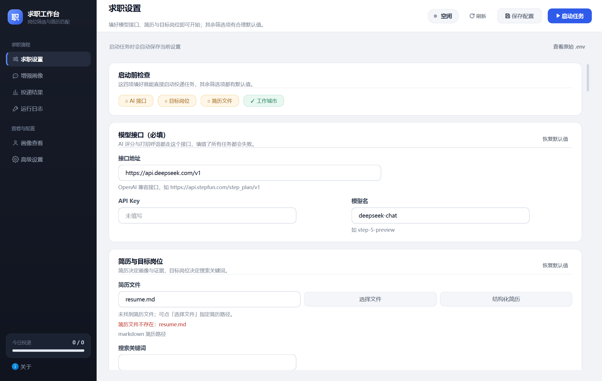

# AutoDeliver 求职工作台

一款基于 Python、PySide6 和大模型的 Windows 桌面求职辅助工具，将岗位检索、简历与 JD 匹配评估、招呼语起草和投递记录整理到一个工作台中。

**目前仅支持 BOSS 直聘。** 暂未适配其他招聘平台。本项目为独立工具，与 BOSS 直聘不存在官方隶属、合作或授权关系。

[下载 v1.0.0](https://gitee.com/yan-ace/automated-delivery/releases/tag/v1.0.0) · [使用说明与免责声明](DISCLAIMER.md) · [反馈问题](https://gitee.com/yan-ace/automated-delivery/issues) · [发行验证记录](docs/windows-release-1.0.0.md)

## 界面预览



截图来自隔离自检环境，展示未填写个人信息的初始设置状态，不包含真实简历、API Key 或投递记录。

## 能做什么

| 功能 | 说明 |
| --- | --- |
| 岗位检索与筛选 | 在 BOSS 直聘检索目标岗位，按城市、区域、行业、职位类型及求职条件缩小范围 |
| 简历与 JD 评估 | 对照岗位描述与候选人材料给出匹配分数、简历证据、硬性缺口和待核实要求 |
| 个性化招呼语 | 围绕 JD 的具体职责和真实项目经历起草首条消息，支持调整提示词 |
| 候选人画像 | 从简历建立基础信息，通过可选的访谈补充经历、能力和求职偏好 |
| 历史岗位去重 | 结合岗位标识和历史结果跳过已完成处理的岗位，减少重复工作 |
| 已沟通岗位识别 | 识别当前职位的“已沟通”“继续沟通”等状态，跳过重复评分、招呼语生成及发送 |
| 试运行与正式模式 | 先查看筛选、评分和招呼语结果，再决定是否启用真实发送 |
| 结果与日志 | 按状态、关键词和分数筛选结果，查看岗位详情、匹配理由和运行日志 |
| 桌面配置管理 | 通过界面保存设置，提供保存结果提示及启动前检查 |

评分用于辅助判断，不代表招聘方评价，也不保证面试机会或录用结果。平台页面或接口变化可能影响功能可用性。

## 下载与安装

| 发行文件 | 适用场景 | 大小 |
| --- | --- | ---: |
| [Windows 安装包](https://gitee.com/yan-ace/automated-delivery/releases/download/v1.0.0/AutoDeliver-Setup-1.0.0-win64.exe) | 推荐使用，提供安装向导、开始菜单入口及卸载功能 | 约 67 MiB |
| [Windows 便携版](https://gitee.com/yan-ace/automated-delivery/releases/download/v1.0.0/AutoDeliver-1.0.0-win64-portable.zip) | 完整解压后直接启动 | 约 86 MiB |
| [SHA-256 校验文件](https://gitee.com/yan-ace/automated-delivery/releases/download/v1.0.0/SHA256SUMS.txt) | 核对两个发行包的完整性 | 203 字节 |

运行环境：

- Windows 10 1903 或更新版本、Windows 11，64 位。当前没有 macOS/Linux 安装包。
- 安装 Chrome 或 Edge，用于 BOSS 直聘登录及岗位操作；本工具不附带浏览器。
- 准备可用的 OpenAI 兼容 AI 接口、API Key 和模型名称。
- 安装包与便携版自带 Python 运行环境，无需另装 Python 或 Conda。

安装版运行 `AutoDeliver-Setup-1.0.0-win64.exe` 后按向导操作。便携版完整解压 ZIP，运行 `AutoDeliver/AutoDeliver.exe`；不要单独移动主程序，需保留同目录的 `_internal` 和 `auto_deliver_worker.exe`。便携版也使用下文列出的 AppData 数据目录。

当前 EXE 和安装包尚未代码签名，Windows 可能显示“未知发布者”或信誉提示。请核对下载来源与校验值，无需关闭系统安全软件。

## 首次使用

1. 打开软件，在“求职设置”中填写 AI 接口地址、API Key 和模型名称。接口应支持 OpenAI 兼容的聊天调用。
2. 选择自己的 Markdown 或 TXT 简历，填写目标岗位关键词和工作城市；按需设置区域、行业、职位类型等条件。当前不直接解析 PDF 或 Word 简历。
3. 按需使用“增强画像”补充经历和求职偏好，检查画像中的事实。该步骤可在基础配置完成后继续完善。
4. 点击“保存配置”，确认保存提示。先启用试运行，再启动任务；需要登录时，在软件打开的浏览器中自行完成 BOSS 直聘登录或验证。
5. 在“投递结果”中查看评分、筛选理由、证据和招呼语，并通过“运行日志”检查问题。
6. 确认简历、筛选条件、生成内容和运行范围后，再关闭试运行并启动正式任务。正式模式可能按配置自动发送消息，已发送的信息可能无法撤回。

使用流程：配置与简历 → BOSS 直聘检索 → 去重及条件筛选 → JD 匹配评估 → 招呼语 → 试运行记录或正式发送 → 结果保存。

## 主要配置

大部分设置可直接在桌面界面中修改，无需手动编辑文件。

| 配置 | 用途与注意事项 |
| --- | --- |
| AI 接口 | 配置接口地址、密钥、模型、超时和重试；调用费用由对应服务商计收 |
| 简历与画像 | 使用本人真实资料，画像内容应人工核对，不能把岗位要求当作已有经历 |
| 搜索与筛选 | 设置关键词、城市、区域、行业和职位类型，搜索页数决定请求范围 |
| 匹配阈值 | 控制进入后续处理的分数要求，分数仍需结合理由和证据判断 |
| 运行范围与节奏 | 调整处理数量、每日投递上限和间隔；页数、处理量和发送量是不同设置 |
| 试运行 | 保留检索、评估和结果记录，不实际发送招呼语 |
| 浏览器路径 | 一般自动发现 Chrome/Edge；失败时可在高级设置指定 `BROWSER_PATH` |
| 后台浏览器 | 已有有效登录时可后台运行，需要登录或验证时仍可能显示浏览器 |
| Tavily 搜索 | 可选，用于画像访谈中的市场资料补充；主投递流程不依赖它，未配置时可继续基础访谈 |

历史去重会区分完成状态与失败状态。失败记录可以重试；试运行结果在切换正式模式后仍可进入正式处理。调整条件后看到某个历史岗位被跳过时，应先核对原记录，避免误删投递历史。

## 数据位置

以下为默认位置，自定义结果或简历路径时以实际配置为准：

| 内容 | 默认路径 |
| --- | --- |
| 配置 | `%APPDATA%\AutoDeliver\.env` |
| 投递结果 | `%APPDATA%\AutoDeliver\deliver_results.csv` |
| 每日记录 | `%APPDATA%\AutoDeliver\deliver_log.json` |
| 候选人画像、摘要和访谈缓存 | `%APPDATA%\AutoDeliver` |
| 面板启动日志 | `%APPDATA%\AutoDeliver\panel-startup.log` |
| 浏览器登录信息 | `%USERPROFILE%\.boss-zhipin-scraper\chrome-profile` |

可在资源管理器地址栏输入 `%APPDATA%\AutoDeliver` 打开数据目录。安装和卸载默认保留用户数据；迁移或清理前请先备份。简历保存在用户自行选择的位置。

API Key 当前保存在本地配置文件中，并非加密凭据库。进行 AI 评估、招呼语生成或画像访谈时，相关简历、JD 和访谈内容会发送到用户配置的服务；启用搜索时，相应查询会发送至搜索服务。

发行包不携带开发者的简历、密钥、画像、投递记录或浏览器登录数据。请勿将自己的 `.env`、结果文件、浏览器资料目录提交到仓库。

## 常见问题

**支持哪些招聘平台？**

目前仅支持 BOSS 直聘，其他招聘平台尚未适配。

**为什么还需要 AI 接口？**

简历与 JD 评估、招呼语生成和画像访谈依赖你配置的模型服务。软件不内置免费模型额度，API Key 也需要自行申请。

**试运行会发送消息吗？**

不会发送招呼语，但会执行岗位检索及 AI 评估，因此仍可能消耗模型额度。正式模式才可能按配置执行发送。

**为什么仍会弹出浏览器？**

首次登录、登录失效或平台要求验证时，需要用户操作。后台浏览器设置不能代替登录，也不保证绕过平台限制。

**“继续沟通”的岗位会重复发送吗？**

当前流程会识别已沟通状态并跳过，发送前也会再次检查。若平台页面结构发生变化，识别可能失效；发现异常应停止任务并反馈。

**已有投递结果，为什么某些岗位还会处理？**

去重依据岗位标识及结果状态。失败记录允许重试；试运行结果转正式模式时也允许继续。若已完成岗位仍重复处理，可提交脱敏日志帮助定位。

**找不到浏览器或简历怎么办？**

安装 Chrome/Edge，或在高级设置中填写浏览器可执行文件路径。简历应重新通过“选择文件”指定有效的 Markdown/TXT 文件。

## 开发与构建

主要技术：Python 3.11、PySide6、DrissionPage、LangChain、Pydantic。配置使用 `.env`，投递结果使用 CSV，画像及缓存使用 JSON。

### 源码运行

在 Windows 上安装 Python 3.11，克隆项目并建立独立环境：

```powershell
git clone https://gitee.com/yan-ace/automated-delivery.git
cd automated-delivery
py -3.11 -m venv .venv
.\.venv\Scripts\python.exe -m pip install -r requirements.txt
.\.venv\Scripts\python.exe desktop_panel.py
```

也可双击 `启动面板.vbs` 无控制台启动。该入口优先检查 `AUTODELIVER_PYTHONW` 和项目 `.venv`，可用前者指定解释器。

### 自动化检查

测试额外需要 `pytest`，它不属于最终用户的运行依赖：

```powershell
.\.venv\Scripts\python.exe -m pip install pytest
$env:QT_QPA_PLATFORM = "offscreen"
.\.venv\Scripts\python.exe -X utf8 -B -m pytest tests -q
Remove-Item Env:QT_QPA_PLATFORM
.\.venv\Scripts\python.exe -X utf8 -B scripts/check_sensitive_data.py
```

v1.0.0 发布时通过 402 项测试和 137 项子测试，并完成打包后界面、后台程序、浏览器启动、安装及卸载验证。测试没有发送真实投递消息，不构成匹配效果或平台可用性的保证。详细范围见[发行验证记录](docs/windows-release-1.0.0.md)。

### Windows 打包

安装构建依赖、测试依赖和 Inno Setup 6.7.4 后运行：

```powershell
.\.venv\Scripts\python.exe -m pip install -r requirements-build.txt pytest
powershell -ExecutionPolicy Bypass -File scripts/build_windows.ps1 -Python ".\.venv\Scripts\python.exe" -Iscc "Inno Setup 安装目录\ISCC.exe"
```

EXE 输出到 `dist/AutoDeliver/`，安装包及便携 ZIP 输出到 `release/`。构建脚本默认执行测试及冻结程序自检，并使用资源白名单打包。

打包后可执行独立自检，不调用外部 AI 或发送真实消息：

```powershell
.\dist\AutoDeliver\AutoDeliver.exe --self-check "完整路径\release-check.json"
```

### 项目结构

```text
desktop_panel.py          桌面主窗口与配置管理
panel_*.py                画像、结果、日志及通用界面组件
auto_deliver.py           岗位处理与投递流程
boss_spider.py            BOSS 直聘浏览器及岗位数据访问
ai_chains.py / ai_client.py  模型调用与结构化输出
greeting_prompt.py        招呼语默认提示词
candidate_profiles.py     候选人画像及证据整理
job_profiles.py           岗位方向与检索配置
result_store.py           投递结果保存及历史去重
packaging/                Windows 打包与安装器配置
scripts/                  构建、敏感信息检查及验证工具
tests/                    自动化测试
docs/                     设计、运行说明和发行验证记录
```

浏览器运行机制可进一步阅读[后台浏览器与启动说明](docs/quiet-startup.md)、[运行协调与心跳说明](docs/runtime-heartbeat.md)。

## 反馈与贡献

欢迎通过 [Gitee Issues](https://gitee.com/yan-ace/automated-delivery/issues) 提交问题或改进建议。问题报告建议包含软件版本、Windows 与浏览器版本、试运行或正式模式、复现步骤，以及脱敏后的日志或截图。

请移除 API Key、Cookie、登录信息、完整个人简历和招聘方私聊内容。修改代码后运行相关测试；新增平台支持、发送逻辑或数据格式变更，建议先说明设计与验证范围。

## 作者与许可

- 作者：**Gnahz**
- 邮箱：[875931932@qq.com](mailto:875931932@qq.com)
- GitHub 个人主页：[github.com/875931932](https://github.com/875931932)
- Gitee 项目：[yan-ace/automated-delivery](https://gitee.com/yan-ace/automated-delivery)

以上为作者主动公开的项目联系方式。软件侧栏“关于”窗口也提供联系方式和完整免责声明。

项目代码许可见 [Academic Free License 3.0](LICENSE)。第三方组件依各自许可证使用，详见 [THIRD_PARTY_NOTICES.md](THIRD_PARTY_NOTICES.md)；免责声明不替代代码许可证或第三方许可条款。

仅使用本人或已获得明确授权的账号与资料，并遵守平台规则。请合理设置运行范围与频率，遇到登录、验证或限制提示时按平台要求处理。完整说明见 [DISCLAIMER.md](DISCLAIMER.md)。
